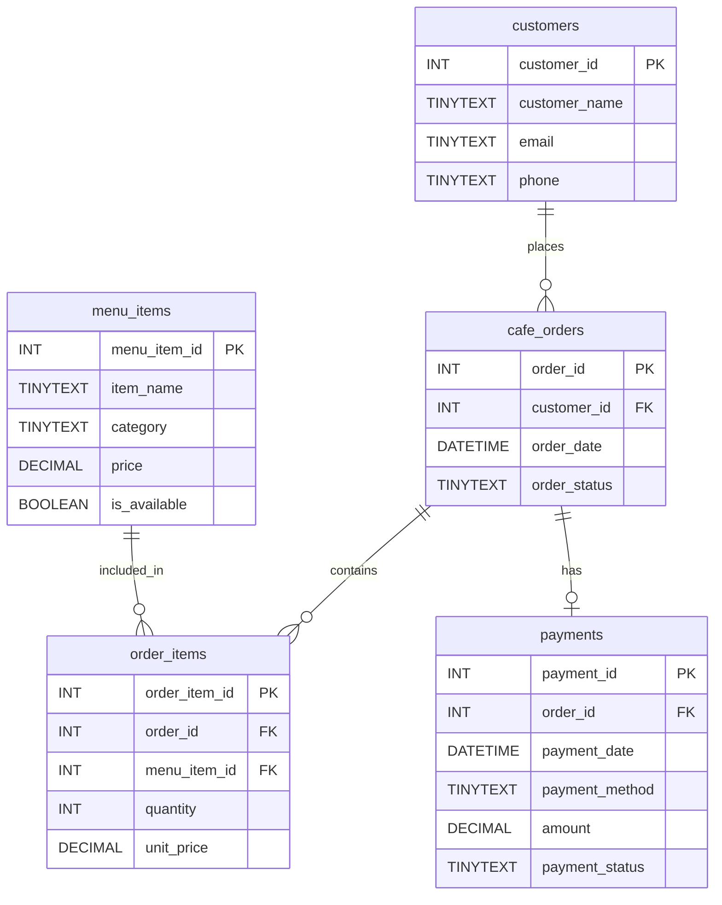

# Campus Cafe Database Project

Our project is a database for a campus cafe. The database tracks customers, menu items, cafe orders, items included in orders, and payments. It can support a future PHP website where students and staff place food and drink orders.

## Data Model

The database uses **exactly five tables**. Each table shows its columns, data types, primary key (PK), and foreign keys (FK) in this Mermaid ER diagram.



### Tables and what they track

| Table | Purpose | Primary key | Foreign keys |
| --- | --- | --- | --- |
| `customers` | Customer names and contact information | `customer_id` | None |
| `menu_items` | Food and drink items, categories, prices, and availability | `menu_item_id` | None |
| `cafe_orders` | Customer orders, dates, and order status | `order_id` | `customer_id` -> `customers` |
| `order_items` | Specific menu items and quantities in each order | `order_item_id` | `order_id` -> `cafe_orders`; `menu_item_id` -> `menu_items` |
| `payments` | Payment details and payment status | `payment_id` | `order_id` -> `cafe_orders` |

### Relationship rules

- **One customer** can place **zero or many cafe orders**; each order belongs to exactly one customer.
- **One cafe order** can contain **zero or many order items**; each order item belongs to exactly one order.
- **One menu item** can appear in **zero or many order items**; each order item refers to exactly one menu item.
- **One cafe order** can have **zero or one payment**; each payment refers to exactly one order. A `UNIQUE` constraint on `payments.order_id` enforces this.
- `cafe_orders` and `menu_items` have a **many-to-many relationship** resolved by the `order_items` junction table.

The SQL file uses `TINYTEXT` for text columns and `DECIMAL(8,2)` for monetary values. It also applies primary key, foreign key, `NOT NULL`, `UNIQUE`, and `CHECK` constraints. All five tables use InnoDB so MariaDB enforces foreign keys.

## Create the Database

1. On our Debian LAMP server, open phpMyAdmin (`http://<VM-IP>/phpmyadmin`, or `http://localhost:8080/phpmyadmin` if using VirtualBox NAT port forwarding).
2. Log in with a MariaDB user that has permission to create tables and databases.
3. Use the **Import** tab at server level to import [`database/schema.sql`](database/schema.sql), or paste its contents into the **SQL** tab and click **Go**.
4. Confirm the **campus_cafe** database shows exactly five tables: `customers`, `menu_items`, `cafe_orders`, `order_items`, and `payments`.
5. Optional: import [`database/sample_data.sql`](database/sample_data.sql) once to add practice records.
6. Save an actual phpMyAdmin screenshot in [`screenshots/`](screenshots/) showing `campus_cafe` expanded with the five tables.

For a quick check in phpMyAdmin, run:

```sql
USE campus_cafe;
SHOW TABLES;
```

## Project Files

- `README.md` — campus cafe description and Mermaid ER diagram.
- `database/schema.sql` — complete CREATE DATABASE and five CREATE TABLE statements.
- `database/sample_data.sql` — optional sample records for testing.
- `screenshots/` — actual browser screenshot showing the created database and tables (add after running `schema.sql`).

## Submission

Push these files and the phpMyAdmin screenshot to the team's GitHub repository. Add all team members as collaborators. Submit the **GitHub repository link** in Canvas.
