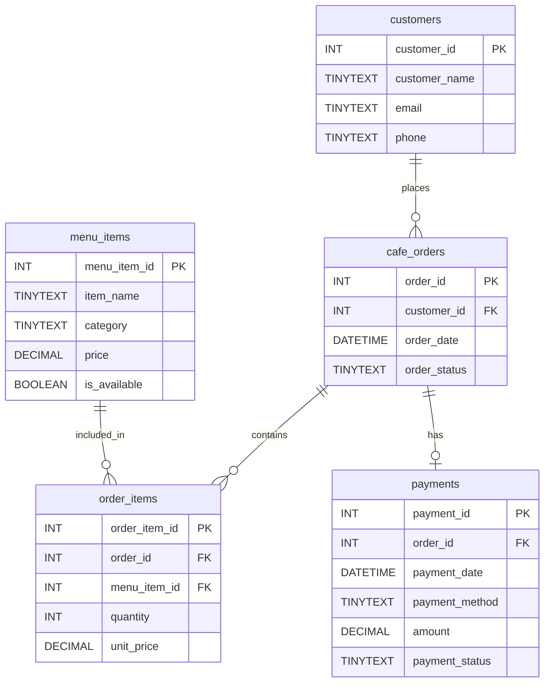
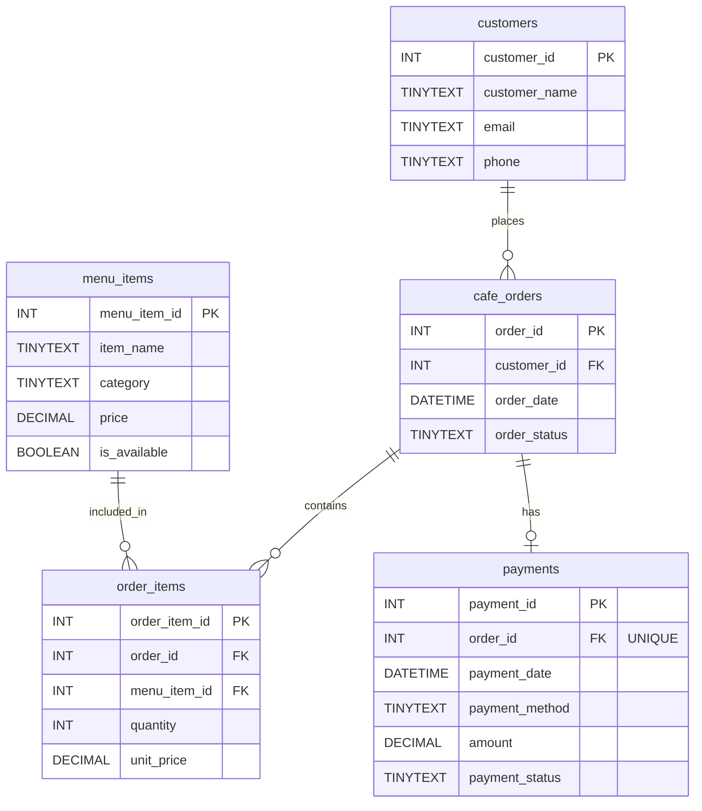
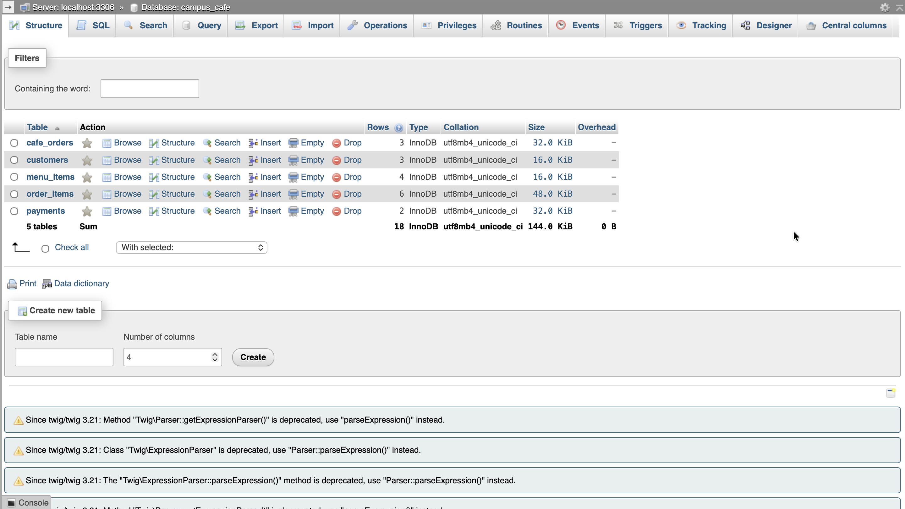
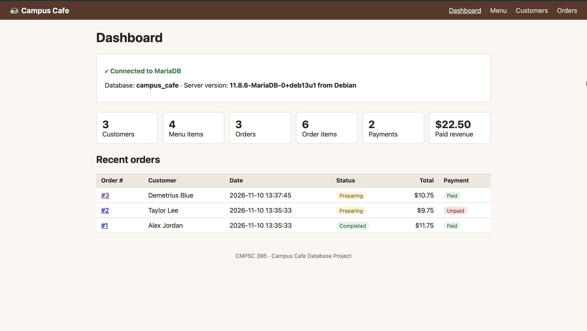
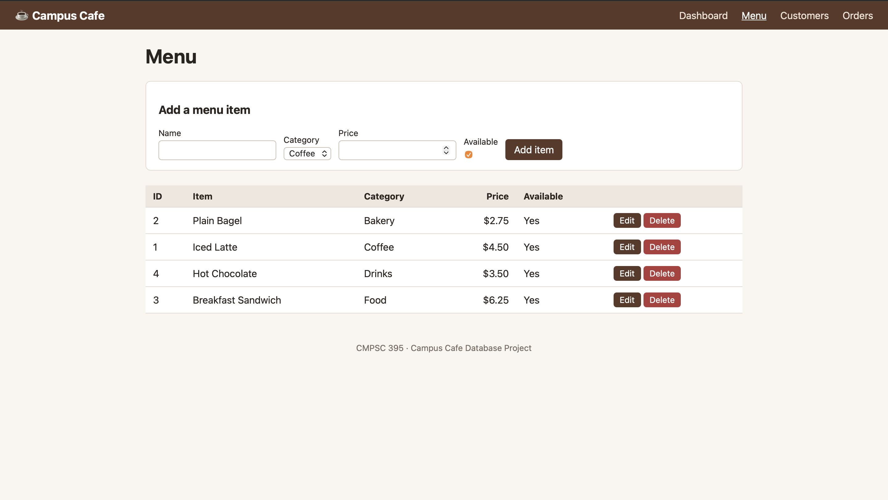
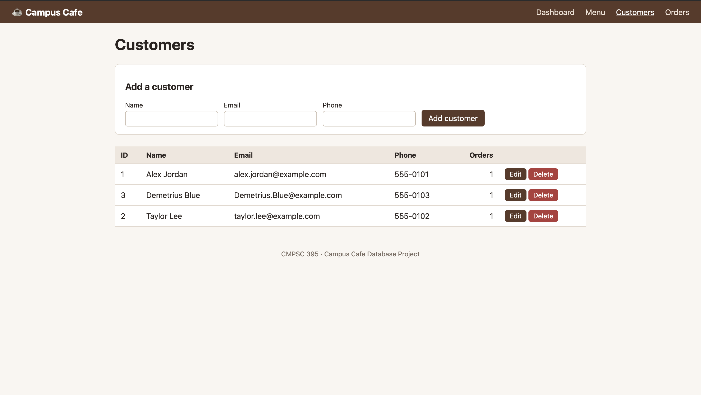
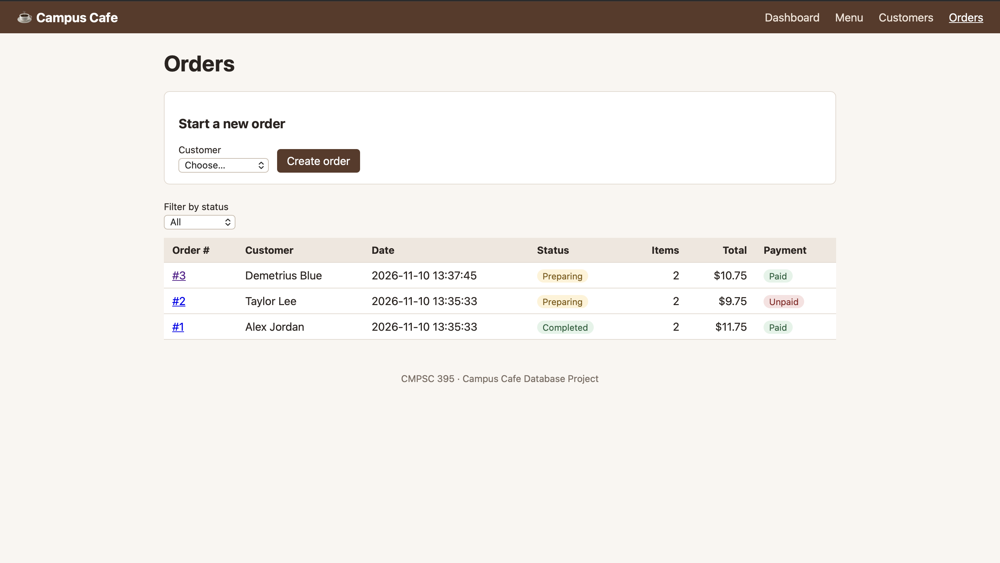
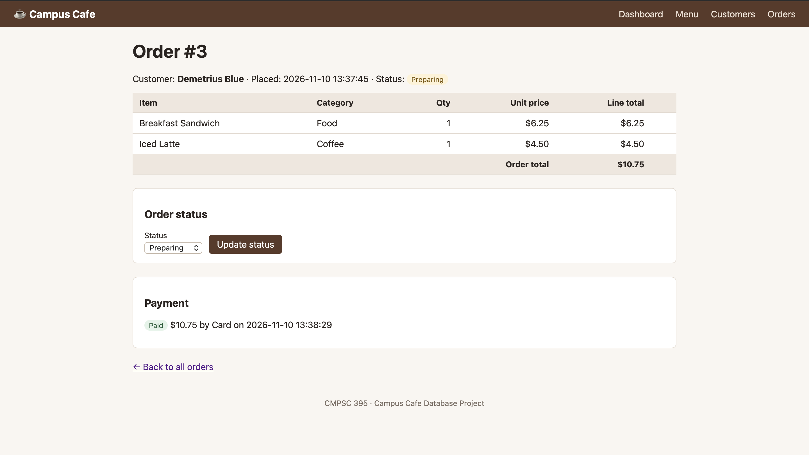

# Campus Cafe Database Project

Our project is a database for a campus cafe. The database tracks customers, menu items, cafe orders, items included in orders, and payments. It can support a future PHP website where students and staff place food and drink orders.

## Data Model

The database uses **exactly five tables**. Each table shows its columns, data types, primary key (PK), and foreign keys (FK) in this Mermaid ER diagram.



### Tables and what they track

| Table | Purpose | Primary key | Foreign keys |
| --- | --- | --- | --- |
| `customers` | Customer names and contact information | `customer_id` | None |
| `menu_items` | Food and drink items, categories, prices, and availability | `menu_item_id` | None |
| `cafe_orders` | Customer orders, dates, and order status | `order_id` | `customer_id` -> `customers` |
| `order_items` | Specific menu items and quantities in each order | `order_item_id` | `order_id` -> `cafe_orders`; `menu_item_id` -> `menu_items` |
| `payments` | Payment details and payment status | `payment_id` | `order_id` -> `cafe_orders` |

### Relationship rules

- **One customer** can place **zero or many cafe orders**; each order belongs to exactly one customer.
- **One cafe order** can contain **zero or many order items**; each order item belongs to exactly one order.
- **One menu item** can appear in **zero or many order items**; each order item refers to exactly one menu item.
- **One cafe order** can have **zero or one payment**; each payment refers to exactly one order. A `UNIQUE` constraint on `payments.order_id` enforces this.
- `cafe_orders` and `menu_items` have a **many-to-many relationship** resolved by the `order_items` junction table.

The SQL file uses `TINYTEXT` for text columns and `DECIMAL(8,2)` for monetary values. It also applies primary key, foreign key, `NOT NULL`, `UNIQUE`, and `CHECK` constraints. All five tables use InnoDB so MariaDB enforces foreign keys.

## Create the Database

1. On our Debian LAMP server, open phpMyAdmin (`http://<VM-IP>/phpmyadmin`, or `http://localhost:8080/phpmyadmin` if using VirtualBox NAT port forwarding).
2. Log in with a MariaDB user that has permission to create tables and databases.
3. Use the **Import** tab at server level to import [`database/schema.sql`](database/schema.sql), or paste its contents into the **SQL** tab and click **Go**.
4. Confirm the **campus_cafe** database shows exactly five tables: `customers`, `menu_items`, `cafe_orders`, `order_items`, and `payments`.
5. Optional: import [`database/sample_data.sql`](database/sample_data.sql) once to add practice records.
6. Save an actual phpMyAdmin screenshot in [`screenshots/`](screenshots/) showing `campus_cafe` expanded with the five tables.

For a quick check in phpMyAdmin, run:

```sql
USE campus_cafe;
SHOW TABLES;
```

## Project Files

- `README.md` — campus cafe description, Mermaid ER diagram, and project check-ins.
- `database/schema.sql` — complete CREATE DATABASE and five CREATE TABLE statements.
- `database/sample_data.sql` — optional sample records for testing.
- `app/` — PHP web application (PDO connection to MariaDB).
- `screenshots/` — phpMyAdmin and web app screenshots.

## Submission

Push these files and the phpMyAdmin screenshot to the team's GitHub repository. Add all team members as collaborators. Submit the **GitHub repository link** in Canvas.

---

## Project Check-In 1 — November 10, 2026

### Project description

Campus Cafe is a web app for running a campus cafe's ordering system. Staff can manage the menu and customer list, start an order for a customer, add food and drink items to it, move it through its status (Pending → Preparing → Completed), and record a payment. Everything is stored in our five-table `campus_cafe` MariaDB database, and the PHP pages read and write that data through PDO, following the week 11 CRUD demo.

### Current features

All of these work right now against the live database:

- **Database connection check** — the dashboard (`index.php`) confirms PHP is connected to MariaDB and shows the database name and server version.
- **Dashboard** — row counts for all five tables, total paid revenue, and the five most recent orders with totals and payment status.
- **Menu management** (`menu.php`) — add, edit, and delete menu items; set category, price, and availability.
- **Customer management** (`customers.php`) — add, edit, and delete customers, with email validation and an order count for each customer.
- **Orders list** (`orders.php`) — every order with its customer, item count, total, and payment status, plus a filter by order status.
- **Create an order** — pick a customer to start a new order.
- **Order details** (`order.php`) — add menu items with a quantity, remove items, see the running total, and update the order status.
- **Payments** — record one payment per order (Cash, Card, or Meal Plan) for the order total.
- **Database rules shown in the app:**
  - A customer with orders, or a menu item that's in an order, can't be deleted. The foreign key blocks it and the page shows a friendly message.
  - An order can only be paid once (`UNIQUE` on `payments.order_id`).
  - Items lock after payment.
  - Unavailable menu items can't be added to orders.
- **Basic security:**
  - Every query uses prepared statements, so user input can't cause SQL injection.
  - All output is escaped with `htmlspecialchars`, so entered text can't inject HTML or scripts.
  - Database credentials live in `config.php`, which is in `.gitignore` and never pushed.

### Database schema

**No schema changes since week 9.** The app was built to fit the original design, so [`database/schema.sql`](database/schema.sql) and the ERD below are current. `order_items.unit_price` turned out to be important: the app copies the menu price into it when an item is added, so changing a menu price later doesn't change the totals of past orders.



### Screenshots

**Database tables in phpMyAdmin**



**PHP connected to MariaDB** — the dashboard reads live data from all five tables



**Menu management**



**Customer management**



**Orders list**



**Order details with items and payment**



### Running the app

1. Import `database/schema.sql` (and optionally `database/sample_data.sql`) in phpMyAdmin.
2. Copy the `app/` folder to the web server, for example `/var/www/html/campus-cafe/`.
3. In `app/`, copy `config.example.php` to `config.php` and enter your MariaDB username and password.
4. Open `http://<VM-IP>/campus-cafe/` in a browser.

### Progress summary

**Complete**

- Five-table database with primary keys, foreign keys, and `CHECK`/`UNIQUE` constraints.
- PHP connected to MariaDB with PDO.
- Full create, read, update, and delete for menu items and customers.
- Order workflow: create an order, add and remove items, update status, record payment.
- Dashboard with live counts and recent orders.

**Not complete / known issues**

- **No login.** Anyone who can reach the site can edit data. We plan to add a staff login before the final.
- **No CSRF tokens** on the forms yet.
- **Orders can't be deleted or cancelled with a refund.** Setting the status to Cancelled doesn't touch the payment.
- **Status values are only checked in PHP.** `order_status`, `payment_method`, and `payment_status` are `TINYTEXT` in the database, so the allowed values (like Pending/Preparing/Completed/Cancelled) are enforced only by the app. We may switch these to `ENUM` or a lookup table.
- **No customer-facing ordering page yet.** Right now the site is a staff tool.
- No search or sales reports yet.

**Blockers / help needed**

- No blockers right now.
- **Question for feedback:** should we change the status columns to `ENUM` (a schema change), or keep `TINYTEXT` and validate in PHP?

**Next steps**

1. Add a staff login with a `staff` table and hashed passwords.
2. Add CSRF tokens to every form.
3. Add a simple sales report (revenue by day and best-selling items).
4. Add order cancellation that also updates the payment status.
5. Add more sample data and polish the page styling.
